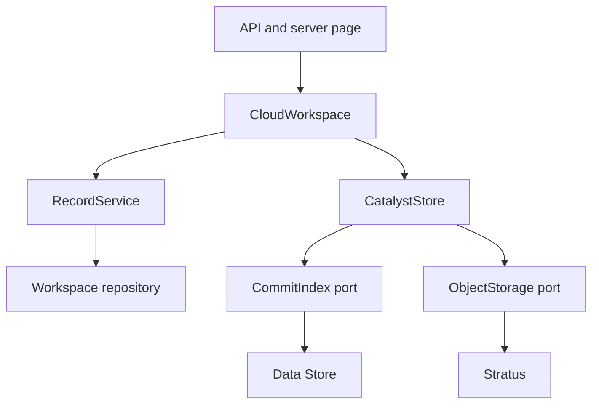

# Clausewise architecture

## Boundaries

Next.js authenticates on the server and loads the owner workspace before rendering. The browser receives business records and connection status; it never receives Catalyst admin credentials, Stratus keys or Gemini secrets. Screen components, the injected HTTP gateway, extraction strategies and the workspace hook retain their existing responsibilities.

`RecordService` applies the registered contract, company-standard and commitment policies through `RecordReader`, `RecordWriter` and `AuditTrail` ports. `SnapshotWorkspaceRepository` implements those ports over one transaction-local workspace state. `CloudWorkspace` coordinates uploads, downloads and domain operations. `CatalystStore` publishes a successful operation through independent `CommitIndex` and `ObjectStorage` ports. Composition in `services.ts` chooses Data Store and Stratus using a request-scoped modular SDK instance.

## Publication and concurrency

The workspace is single-owner. Each mutation loads the latest immutable UTF-8 snapshot, copies it, applies business changes and audit entries, stages the new JSON in Stratus, then inserts a Data Store row with a unique owner/revision commit key. That unique insert is the publication point. Competing writers can publish only one snapshot for a revision; the loser returns 409. A callback error never publishes its draft.

Data Store stores compact ASCII-safe metadata, not large document text or user-supplied query literals. Owner identifiers are hashed for queries; validated commit keys are the only interpolated strings. Revision values from the API are normalized to numbers. Snapshot payload hashes and owner references are checked on load. IDs and filenames supplied by clients never become arbitrary Stratus paths.

The new snapshot contains agreement changes, linked commitment deletion, activity entries and original-object references together. Binary uploads are staged first. Failed or unconfirmed publication is treated carefully: a confirmed competing commit permits cleanup of the losing JSON, while an unknown outcome preserves staged files and asks the user to refresh. A lost HTTP response after a confirmed publication is recovered as success.

Successful saves queue superseded snapshots and deleted originals for cleanup. Failed cleanup remains in the committed state and is retried on later authenticated reads and saves. A reader that races snapshot cleanup retries against the latest commit. Crashes before publication may leave unreferenced objects; there is no unattended retention/orphan-recovery job in this release. Deletion becomes effective in the app immediately, while physical removal can remain pending during a storage outage.

## Authentication and connections

The existing scrypt owner password and signed HttpOnly session cookie remain. Ten uniquely constrained Data Store slots per owner and fixed 15-minute window limit all sign-in attempts across instances, including successful ones. Expired slots receive bounded cleanup after a later successful allocation. This is a fixed-window limit, not a rolling-window claim.

The SDK uses Catalyst gateway credentials for the current request, verifies the project ID and initializes admin scope. There is no shared application credential cache, no refresh-token configuration in the frontend, and no direct browser table access. Keep Data Store App User permissions disabled and Stratus protected. All application operations still apply owner authorization.

Gemini credentials retain owner-bound AES-256-GCM encryption derived from SESSION_SECRET. The connection adapter publishes encrypted credential changes through the same native store. A model-access test cannot mark a replacement key verified. The API never returns a saved key.

## SOLID and verification

Domain decisions depend on repository ports; snapshot publication depends on commit and object ports; frontend orchestration depends on the gateway port. Document formats and record kinds use independent strategies. Validation policies receive a reader, not an all-purpose SDK client. Cloud credentials, transport details and persistence decisions stay outside presentation components.

Tests substitute the narrow persistence ports to exercise real domain and publication logic, including concurrent writers and failure recovery. SDK transport tests verify response envelopes against the installed modular packages. The actual Development Data Store uniqueness and latest-revision query have also been probed, with the temporary verification row removed. These checks do not prove Stratus/AppSail runtime behavior; that remains a deployment verification step after activation.

## Practical limits

Each mutation rewrites review data, capped at 32 MB per workspace snapshot. Original binaries are separate objects capped at 20 MB per upload. This design favors the current private review workspace over enterprise portfolio scale. It does not claim distributed multi-table SQL transactions, vector retrieval, OCR, automatic email scheduling or immutable legal audit certification. See the deployment guide for setup and remaining verification.
