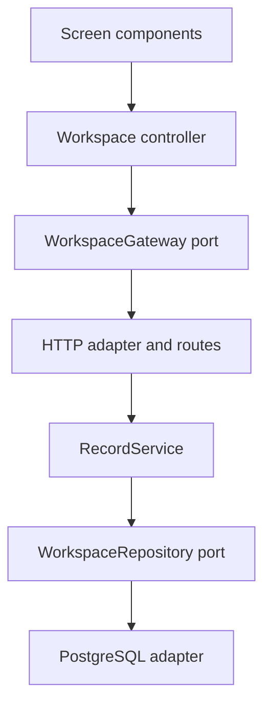

# Clausewise architecture

## Request and render boundaries

The Next.js page authenticates on the server and loads the owner's initial workspace snapshot. That avoids a second client fetch before the first useful view. The client receives business records and connection status, never provider credentials. The page is dynamically rendered per request.

`app/workspace.tsx` coordinates navigation and dialogs. Screen components receive typed records and intent callbacks. `useWorkspace` owns loading, mutations, operation feedback and refresh ordering. It depends on the narrow `WorkspaceGateway` interface; `httpWorkspaceGateway` implements the real API transport. Document extraction is separate from upload transport, with one strategy each for PDF, Word and plain text. PDF and Word libraries load only when the relevant format is used.

API routes authenticate, check the origin, bound the input, and establish a database transaction. `lib/storage.ts` composes the record application service with the PostgreSQL adapter and maps application errors to HTTP errors. `RecordService` contains ownership, revision and business-rule coordination. PostgreSQL queries live in `PostgresWorkspaceRepository`. Document originals and records are inserted together in the existing transaction. Foreign keys handle linked commitment and original deletion.

## How SOLID is applied

| Principle             | Concrete boundary                                                                                                                                                                                                                                                               |
| --------------------- | ------------------------------------------------------------------------------------------------------------------------------------------------------------------------------------------------------------------------------------------------------------------------------- |
| Single responsibility | Views render business records; the controller coordinates operations; extractors read file formats; the gateway sends requests; the record service applies application decisions; the repository persists them.                                                                 |
| Open/closed           | A new document extractor can be registered without rewriting the upload controller. `RecordService` receives a registry of `RecordPolicy` strategies; a new policy behaviour does not require changing the service's command handling.                                          |
| Liskov substitution   | The in-memory repository used by application tests satisfies the same repository port as PostgreSQL. Application-level ownership, revision and audit behaviour runs through both. A substitute must preserve owner scoping and transactional guarantees required by its caller. |
| Interface segregation | `RecordReader`, `RecordWriter` and `AuditTrail` describe separate needs. Validation policies receive a reader, while the service composes those capabilities. Screen props expose only the intents that screen needs.                                                           |
| Dependency inversion  | Application decisions depend on repository ports, and client orchestration depends on the gateway port. Composition chooses PostgreSQL and HTTP at the boundary.                                                                                                                |

The repository test double does not prove SQL locking or cascade behaviour; storage tests execute the migration and real queries using embedded PostgreSQL locally and a PostgreSQL 16 service in CI. These tests complement the application port tests.

## Behaviour worth preserving

- Owner scoping is applied to every record lookup and mutation.
- Mutations lock the current record inside a transaction, reject stale revisions and preserve the original document text, filename, extraction coverage and hash.
- Linked agreement validation is a read-only lookup; it avoids acquiring a second write lock solely to validate a commitment.
- Standard edits create a draft. Existing finding snapshots keep their original rule/version context.
- Accepting a proposal records a review decision. It neither changes the original document nor signs the agreement.
- Refreshes use request ordering so an older response cannot replace a newer workspace snapshot.
- Partially completed multi-file imports refresh the saved records and report how many were saved before a failure.
- API keys remain encrypted in PostgreSQL with owner-bound AES-GCM authentication. Frontend connection management and its provider checks remain separate from agreement presentation.

## Current scope

The record service and workspace flow have explicit ports and policies. Authentication and AI connections retain their existing focused modules; this refactor does not claim a wholesale enterprise domain architecture. PostgreSQL, the protected application origin, owner credentials and session secret must still be configured in Zoho. See `ZOHO_DEPLOYMENT.md` for deployment settings.
