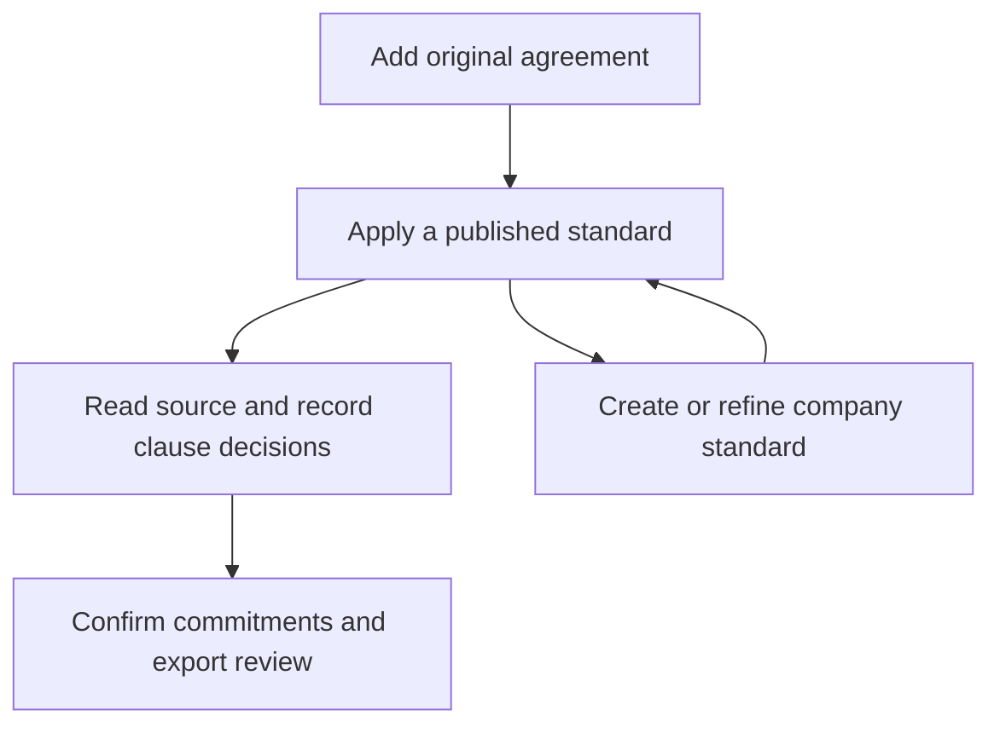
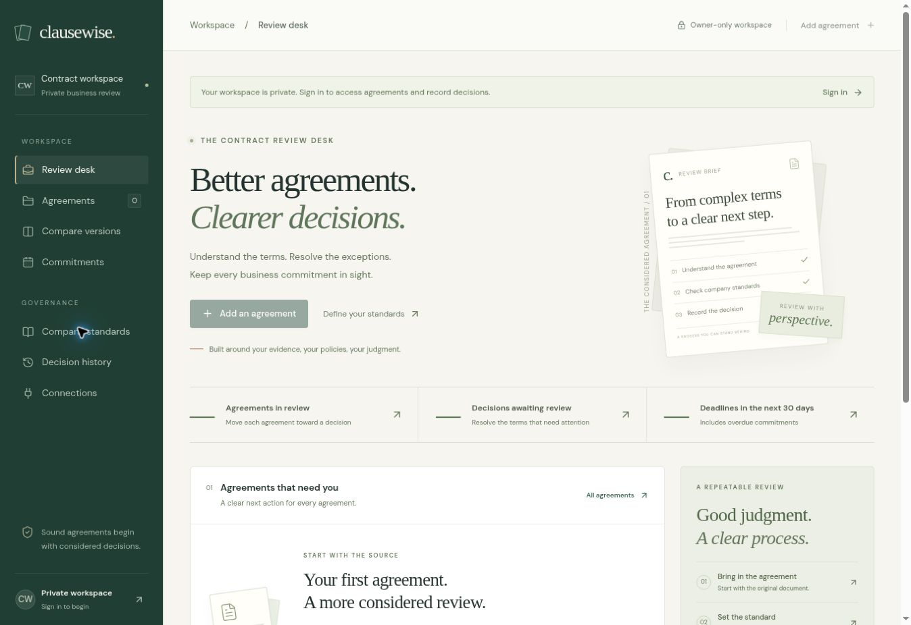

# Clausewise: a considered contract review workspace

## Business purpose

Help a business reviewer understand an agreement, compare it with company expectations, record a reasoned negotiating decision, and assign the commitments that follow. The product is organised around this sequence rather than generic charts or invented risk scores.

The review desk answers three questions: Which agreement needs my attention? What is the next decision? Which confirmed deadline is approaching? Counts derive from actual agreements, saved findings and confirmed commitments. A signed-out visitor sees unavailable counts, not invented business data.

## Storyboard

| Scene                     | Business question                       | Interface and action                                                                                                                                          | Recorded outcome                                                                                                                |
| ------------------------- | --------------------------------------- | ------------------------------------------------------------------------------------------------------------------------------------------------------------- | ------------------------------------------------------------------------------------------------------------------------------- |
| 1. Enter the workspace    | Where do I continue my work?            | Sign in through the private entry screen. The review desk prioritises pending checks, clause decisions and deadlines.                                         | The owner receives only their own agreements and activity.                                                                      |
| 2. Bring in the source    | What exactly are we agreeing to?        | Add one or more PDFs, Word files or text documents. Read extraction coverage and keep the original available.                                                 | Originals and extracted source text are saved together.                                                                         |
| 3. Establish the position | Which business terms are acceptable?    | Create a company standard with required/prohibited wording, priorities and preferred alternatives. Save a draft, then publish.                                | A reusable standard and its current version are recorded.                                                                       |
| 4. Review the terms       | What needs a considered decision?       | Open an agreement and run its published standard. The source and clause decisions share a two-column workspace. Select an excerpt to locate it in the source. | Findings retain the rules and version used for that review.                                                                     |
| 5. Negotiate deliberately | What changed, and what will we propose? | Compare two uploaded versions. Open the relevant agreement, edit proposed wording and accept, decline or reopen each proposal.                                | The current clause decisions and an activity entry are saved. Export the current review before replacing it with a fresh check. |
| 6. Close the loop         | Who acts, and by when?                  | Record a commitment with its agreement, supporting clause, verified deadline and accountable owner. Export a calendar reminder.                               | A confirmed action is linked to the agreement and can be marked complete.                                                       |

## Main user flows

A new reviewer can start with the agreement or define a standard first. If no published standard exists, the review screen links directly to the standards workspace. If AI is not connected, explicit phrase checks, comparison and manual decisions remain available; the question panel links to Connections.

For a revised negotiation, upload the new file as a second agreement, compare the two versions, then open the revised version for its own review. Comparison does not silently overwrite the original. A fresh check explicitly warns before replacing the current finding decisions.

For a renewal, locate the source clause, confirm the action deadline manually, name the responsible person or team, and save the commitment. Calendar export carries a seven-day reminder. The interface explicitly states that automated email delivery is not connected.

## Information architecture and terminology

| Workspace area    | What a business user does                                             |
| ----------------- | --------------------------------------------------------------------- |
| Review desk       | Chooses the next agreement or deadline requiring attention            |
| Agreements        | Finds an original source, its current review stage and open decisions |
| Company standards | Defines and publishes the organisation's expected wording             |
| Compare versions  | Reviews changed or removed paragraphs between two files               |
| Commitments       | Assigns and tracks confirmed actions and dates                        |
| Decision history  | Finds recent uploads and review updates                               |
| Connections       | Adds, tests, replaces or removes the Gemini API key                   |

Business terminology is paired with plain descriptions. The UI uses “company standard” instead of an unexplained “playbook,” “commitment” with an explicit owner and deadline, and “source excerpt” for supporting evidence. It does not imply that an accepted proposal signs a contract or establishes legal compliance.

## Visual system

- Deep green `#203e34` anchors navigation and the private entry screen.
- Warm paper `#f6f5f0` distinguishes the workspace from the white evidence surfaces.
- Forest green `#254c40` marks the primary action; copper `#bb7652` is a restrained editorial accent.
- Amber and terracotta indicate a review priority, not a legal conclusion. Text labels accompany colour.
- A serif headline gives the agreement context an editorial character. DM Sans and system fallbacks support readable controls and records.
- The desk uses a single document folio illustration, a flat operational summary and an agreement queue. There are no decorative charts or seeded customer records.
- Whitespace separates the decision, its evidence and its next action. Small metadata is secondary to agreement names and actionable text.

## Responsive behaviour

The persistent rail becomes a labelled navigation dialog below 1000 px. The review source and decision columns become selectable panes below 600 px, while quote selection changes to the source pane and scrolls to the evidence. Agreement tables become two-column records with labelled decision counts. Comparisons, forms and company-standard cards stack. Text wraps for long file names and owner names. Controls retain visible focus, and reduced-motion preferences are respected.

Native modal dialogs provide Escape handling, focus containment and focus restoration. Inputs have visible labels. Filters announce their pressed state. Loading and errors use status/alert semantics. A skip link leads to the workspace content. AI setup never returns a saved credential to the browser.

## Boundaries that the interface preserves

This release uses phrase checks and paragraph comparison. It has no semantic risk scoring, OCR, automatic obligation extraction, team approval routing, tracked Word changes or scheduled email. The review history lists recent activity; it is not an immutable legal audit system. The current decisions can be exported before re-running checks. The existing Zoho database and sign-in configuration remain necessary before live use.

## Verification record

The production build, TypeScript check, storage regressions and credential checks are run for this change. Additional application tests cover a substitute repository, an extended validation policy, account ownership, workflow stages, deadline boundaries and calendar escaping. Browser preview can render the private entry screen, but its client blocks the application JavaScript bundle; interactive and mobile browser verification remains incomplete in this environment. A configured Zoho deployment still needs a final sign-in/upload/review/calendar smoke test.

## Interface preview

This is the implemented, signed-out workspace. Private counts are intentionally unavailable; no example customer agreements or risk metrics are seeded.
